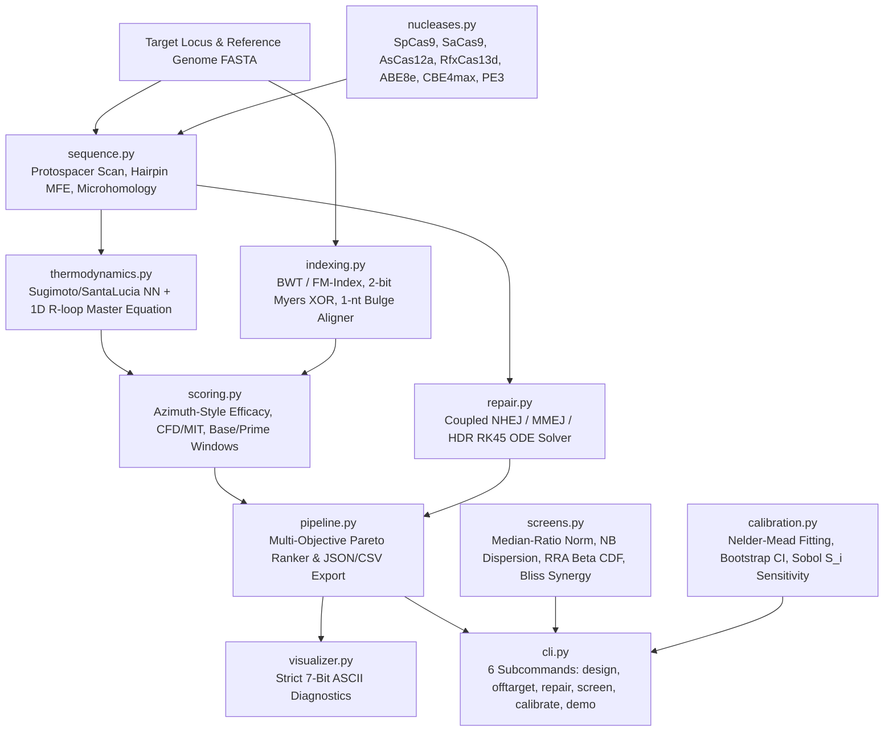
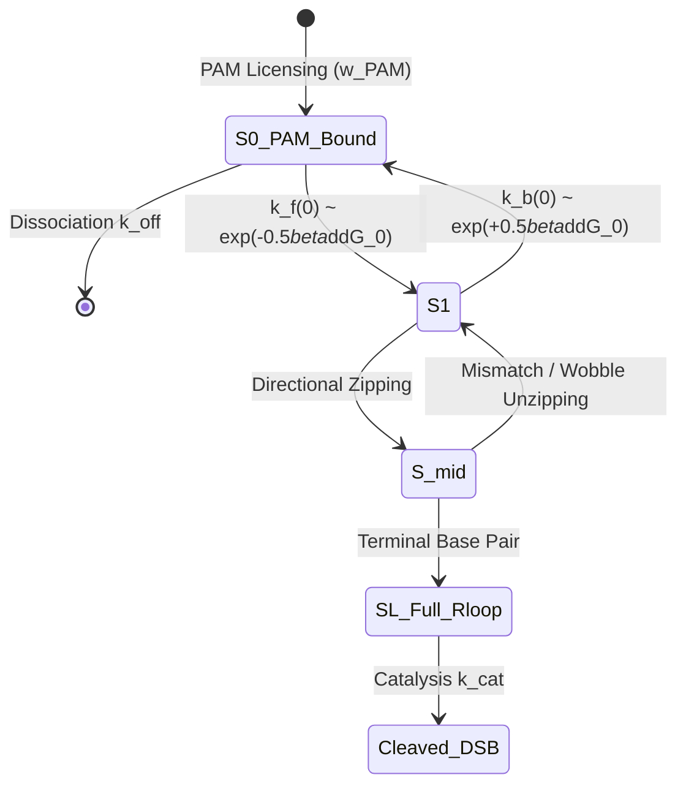

# NucleasePrism

[](#continuous-integration)
[](LICENSE)
[](#scientific-overview)
[](#numerical-verification--benchmarks)

**NucleasePrism** is a biophysical CRISPR guide-RNA design, genome-wide off-target alignment, DNA double-strand break (DSB) repair kinetics, and pooled functional screen analysis suite. Rather than treating guide selection as a purely heuristic sequence-matching lookup, NucleasePrism couples nearest-neighbor RNA:DNA strand-invasion thermodynamics, a continuous-time Markov R-loop propagation master equation, a compressed Burrows-Wheeler Transform (FM-index) with 1-nt DNA/RNA bulge alignment, coupled NHEJ/MMEJ/HDR differential equations, and exact Beta order-statistic Robust Rank Aggregation (RRA) into a unified multi-objective Pareto ranking pipeline.

---

## Table of Contents

1. [Scientific Overview](#scientific-overview)
2. [System Architecture & Module Map](#system-architecture--module-map)
3. [Mathematical & Biophysical Formulations](#mathematical--biophysical-formulations)
4. [Subsystem-by-Subsystem Reference](#subsystem-by-subsystem-reference)
5. [Installation & Quickstart](#installation--quickstart)
6. [Command-Line Interface Reference](#command-line-interface-reference)
7. [Python SDK Walkthrough](#python-sdk-walkthrough)
8. [Numerical Verification & Benchmarks](#numerical-verification--benchmarks)
9. [7-Bit ASCII Visualization Output](#7-bit-ascii-visualization-output)
10. [Architectural Trade-Offs & Scope Disclaimers](#architectural-trade-offs--scope-disclaimers)

---

## Scientific Overview

Programmable CRISPR-Cas effectors (`SpCas9`, `SaCas9`, `AsCas12a`, `RfxCas13d`) and precision editors (`ABE8e`, `CBE4max`, `PE3`) exhibit tightly coupled biophysical trade-offs:

- **On-Target Cleavage Kinetics**: Driven by the free-energy competition between hybrid RNA:DNA formation and target DNA:DNA duplex melting, modulated by PAM-proximal nucleation barriers, wobble (`rG:dT`) vs purine-purine steric mismatch penalties, spacer self-folding hairpin sequestration ($\Delta G_{\text{MFE}}$), Pol-III `TTTT` termination risk, and chromatin accessibility.
- **Genome-Wide Off-Target Burden**: Driven by PAM licensing (`NGG`/`NAG`/`NGA` for SpCas9; `TTTV` for AsCas12a), position-dependent mismatch survival (CFD and Hsu/MIT clustering), and 1-nt DNA or RNA bulge loop accommodations that escape ungapped Hamming scans.
- **Post-Cleavage DNA Repair Spectrum**: Driven by kinetic competition between fast Non-Homologous End Joining (NHEJ, including `-4` base-templated `+1` insertions), Microhomology-Mediated End Joining (MMEJ across flanking direct repeats), and exogenous donor-driven Homology-Directed Repair (HDR).
- **Functional Screen Interpretation**: Pooled genome-wide knockout/activation screens require library normalization, Negative Binomial overdispersion modeling, and gene-level Robust Rank Aggregation (RRA) with Benjamini-Hochberg FDR control.

---

## System Architecture & Module Map



### R-Loop Kinetic State Space



---

## Mathematical & Biophysical Formulations

### 1. Nearest-Neighbor R-Loop Strand Invasion Free Energy

For a guide spacer $R = (r_1, \dots, r_L)$ invading a double-stranded DNA target $D = (d_1, \dots, d_L)$, the net equilibrium strand-exchange free energy at temperature $T$ (default $310.15\text{ K} = 37^\circ\text{C}$) combines Sugimoto (1995) RNA:DNA hybrid parameters and SantaLucia (1998) DNA:DNA duplex parameters:

$$\Delta G^\circ_{\text{RNA:DNA}} = \Delta H^\circ_{\text{init,RD}} - T \Delta S^\circ_{\text{init,RD}} + \sum_{i=1}^{L-1} \left(\Delta H^\circ_{\text{RD}}(r_i r_{i+1}) - T \Delta S^\circ_{\text{RD}}(r_i r_{i+1})\right)$$

$$\Delta G^\circ_{\text{DNA:DNA}} = \Delta H^\circ_{\text{init,DD}} - T \Delta S^\circ_{\text{init,DD}} + \sum_{i=1}^{L-1} \left(\Delta H^\circ_{\text{DD}}(d_i d_{i+1}) - T \Delta S^\circ_{\text{DD}}(d_i d_{i+1})\right)$$

$$\Delta\Delta G_{\text{R-loop}} = \Delta G^\circ_{\text{RNA:DNA}} - \Delta G^\circ_{\text{DNA:DNA}} + \Delta G_{\text{PAM,init}} + \sum_{k \in \mathcal{M}} \gamma_k \Delta\Delta G_{\text{mm}}(r_k, d_k)$$

where $\gamma_k = \gamma_{\text{seed}} > 1$ inside the nuclease's PAM-proximal seed region (`13..20` for SpCas9; `1..8` for AsCas12a) and $\Delta\Delta G_{\text{mm}}$ differentiates tolerated `rG:dT` wobble pairs ($\approx +1.05\text{ kcal/mol}$) from disruptive purine-purine steric clashes ($\approx +3.15\text{ kcal/mol}$).

Salt-corrected RNA:DNA melting temperature $T_m$ incorporates monovalent cation shielding $[\text{Na}^+]$:

$$\frac{1}{T_m([\text{Na}^+])} = \frac{1}{T_m(1\text{ M})} + (4.29 f_{\text{GC}} - 3.95)\times 10^{-5}\ln[\text{Na}^+] + 9.40\times 10^{-6}\ln^2[\text{Na}^+]$$

### 2. Continuous-Time Markov R-Loop Master Equation

In PAM-to-distal zipping order $s \in \{0, 1, \dots, L\}$, forward and backward transition rates satisfy local detailed balance:

$$k_f(s \to s+1) = k_{\text{zip}} \exp\!\left(-\frac{\beta}{2}\Delta\Delta G_{\text{step}}(s)\right), \qquad k_b(s+1 \to s) = k_{\text{zip}} \exp\!\left(+\frac{\beta}{2}\Delta\Delta G_{\text{step}}(s)\right)$$

with $\beta = (R T)^{-1}$ and $R = 1.9872\times 10^{-3}\text{ kcal}/(\text{mol}\cdot\text{K})$. Absorbing exits occur via PAM dissociation $k_{\text{off}}$ at $s=0$ and catalytic cleavage $k_{\text{cat}}$ at $s=L$ (plus $0.12\,k_{\text{cat}}$ pre-terminal leak at $s=L-1$). Expected dwell times $\boldsymbol{\tau} \in \mathbb{R}_{\ge 0}^{L+1}$ prior to absorption solve the tridiagonal linear system:

$$\mathbf{Q}^\top \boldsymbol{\tau} = -\mathbf{e}_0, \qquad P_{\text{cleave}} = k_{\text{cat}}\,\tau_L + 0.12\,k_{\text{cat}}\,\tau_{L-1}$$

### 3. Genome-Wide Off-Target CFD, MIT, and Specificity Aggregation

Each PAM-licensed off-target hit $j$ discovered by the BWT/FM-index (ungapped $k$-mismatch search + seed-anchored 1-nt DNA/RNA bulge alignment) is scored using Cutting Frequency Determination (CFD) and Hsu/MIT spatial clustering:

$$\text{CFD}_j = w_{\text{PAM}}(\text{PAM}_j) \cdot w_{\text{bulge}}(b_j) \cdot \prod_{p \in \mathcal{M}_j} s_{\text{dist}}(d_{\text{PAM}}(p), r_p, d_p)$$

$$S_{\text{spec}} = \frac{100}{1 + \sum_j \text{CFD}_j \cdot w_{\text{anno}}(j)}, \qquad w_{\text{anno}} \in \{1.0_{\text{exon}},\, 0.75_{\text{promoter}},\, 0.25_{\text{intron}},\, 0.12_{\text{intergenic}}\}$$

### 4. Coupled NHEJ / MMEJ / HDR Repair Differential Equations

Post-cleavage DSB resolution evolves over $t \in [0, 24]\text{ h}$ via an explicit Runge-Kutta (`RK45`) system conserving total state probability $U(t) + N(t) + M(t) + H(t) = 1$:

$$\frac{dU}{dt} = -(k_{\text{NHEJ}} + k_{\text{MMEJ}} + k_{\text{HDR}}) U, \quad \frac{dN}{dt} = k_{\text{NHEJ}} U, \quad \frac{dM}{dt} = k_{\text{MMEJ}} U, \quad \frac{dH}{dt} = k_{\text{HDR}} U$$

with Hill-type donor saturation $k_{\text{HDR}} = k_{\text{HDR},\max} \frac{C_{\text{donor}}^{1.2}}{K_m^{1.2} + C_{\text{donor}}^{1.2}}$ and flanking microhomology weights:

$$w_{\text{MH}}(d, L, f_{\text{GC}}) = \exp(0.62\,L + 0.40\,L\,f_{\text{GC}} - \lambda d)$$

Allele diversity is quantified via Shannon indel entropy $H_{\text{indel}} = -\sum_a p_a \log_2 p_a$.

### 5. Pooled CRISPR Screen Dispersion & Exact RRA Order Statistics

Count matrices undergo DESeq2/MAGeCK median-of-ratios normalization followed by Negative Binomial mean-variance dispersion fitting $\text{Var}(Y) = \mu + \beta\mu + \alpha\mu^2$. For each gene with $k$ guides mapped to normalized percentile ranks $u_{(1)} \le \dots \le u_{(k)} \in (0, 1]$, the exact RRA $p$-value evaluates the Beta order-statistic CDF:

$$p_{\text{RRA}} = \min\!\left(1.0,\; k \cdot \min_{1 \le i \le k} I_{u_{(i)}}(i,\; k - i + 1)\right)$$

followed by Benjamini-Hochberg FDR control.

### 6. Saltelli First-Order Sobol Variance Sensitivity

Parameter influence on $Y = P_{\text{cleave}}(\boldsymbol{\theta})$ across $\boldsymbol{\theta} = (k_{\text{zip}}, E_{\text{prot}}, \gamma_{\text{seed}}, T)$ is quantified via:

$$S_i = \frac{\frac{1}{N}\sum_{m=1}^{N} Y(\mathbf{B}_m)\left[Y(\mathbf{A}_m^{(i)}) - Y(\mathbf{A}_m)\right]}{\text{Var}(Y)}$$

---

## Subsystem-by-Subsystem Reference

| Module | Primary Classes / Functions | Responsibility |
| :--- | :--- | :--- |
| `src/nuclease_prism/types.py` | `NucleaseProfile`, `ProtospacerCandidate`, `ThermodynamicProfile`, `OffTargetHit`, `RepairSpectrum`, `GuideEvaluation`, `BatchDesignReport` | Strongly typed immutable biophysical dataclasses and enums |
| `src/nuclease_prism/nucleases.py` | `NUCLEASE_REGISTRY`, `get_nuclease_profile`, `evaluate_pam_weight`, `matches_iupac`, `pam_zipping_order` | Parameterization for `SpCas9`, `SaCas9`, `AsCas12a`, `RfxCas13d`, `ABE8e`, `CBE4max`, `PE3` |
| `src/nuclease_prism/sequence.py` | `scan_protospacers`, `compute_rna_hairpin_mfe`, `find_microhomologies`, `pol3_terminator_penalty`, `parse_fasta_text` | IUPAC scanning, Zuker/Nussinov hairpin MFE folding, MMEJ repeat detection |
| `src/nuclease_prism/thermodynamics.py` | `KineticParameters`, `analyze_rloop_thermodynamics`, `solve_rloop_master_equation`, `compute_hybrid_melting_temp` | Sugimoto/SantaLucia NN tables, wobble penalties, R-loop master equation |
| `src/nuclease_prism/indexing.py` | `GenomeFMIndex`, `align_single_bulge`, `encode_2bit`, `bit_parallel_hamming`, `brute_force_k_mismatch` | Suffix-array BWT/FM-index, `k`-mismatch DFS, 2-bit XOR Hamming, 1-nt DNA/RNA bulges |
| `src/nuclease_prism/scoring.py` | `score_on_target_efficacy`, `evaluate_off_targets`, `compute_cfd_score`, `compute_mit_score`, `analyze_precision_editing_window` | Efficacy regression, CFD/MIT scoring, base-editor bystander & PE3 PBS/RTT windows |
| `src/nuclease_prism/repair.py` | `RepairKineticRates`, `simulate_repair_time_course`, `predict_repair_spectrum` | RK45 DSB pathway ODEs, `-4` templated `+1` insertions, MMEJ allele distribution |
| `src/nuclease_prism/screens.py` | `analyze_pooled_screen`, `median_ratio_normalize`, `fit_nb_dispersion`, `compute_rra_pvalue`, `benjamini_hochberg`, `compute_bliss_synergy` | Pooled screen normalization, NB dispersion, RRA Beta CDF, AUROC & Bliss synergy |
| `src/nuclease_prism/calibration.py` | `calibrate_rloop_kinetics`, `bootstrap_confidence_interval`, `sobol_rloop_sensitivity` | Bounded Nelder-Mead parameter fitting, bootstrap CI, Saltelli Sobol indices |
| `src/nuclease_prism/pipeline.py` | `GuideDesignPipeline`, `compute_pareto_ranks`, `build_synthetic_benchmark_genome`, `report_to_json`, `report_to_csv` | Multi-objective orchestration, non-dominated Pareto ranking, serialization |
| `src/nuclease_prism/visualizer.py` | `render_design_report`, `render_rloop_energy_profile`, `render_offtarget_alignments`, `render_repair_histogram`, `render_pareto_scatter`, `render_screen_report` | Strict 7-bit ASCII terminal plots & diagnostic tables |
| `src/nuclease_prism/cli.py` | `main`, `build_parser` | Installable `nuclease-prism` & `python -m nuclease_prism.cli` CLI |

---

## Installation & Quickstart

Requires Python **3.11+** with `numpy` and `scipy`.

```bash
git clone https://github.com/ZengLLQ/nuclease-prism.git
cd nuclease-prism
pip install -e .[dev]
```

Run the full built-in end-to-end demonstration:

```bash
nuclease-prism demo --seed 42
```

---

## Command-Line Interface Reference

All subcommands run via either `nuclease-prism <subcommand>` or `python -m nuclease_prism.cli <subcommand>`.

### 1. `design` — Multi-Nuclease Guide Design & Pareto Ranking

```bash
nuclease-prism design --nucleases SpCas9 AsCas12a ABE8e --donor-nm 50 --top-k 15
nuclease-prism design --fasta reference.fa --locus TP53_EXON5 --output-json report.json --output-csv guides.csv
```

### 2. `offtarget` — Genome-Wide FM-Index Mismatch & Bulge Search

```bash
nuclease-prism offtarget --spacer GCTAGCTAGCATCGATCGAT --nuclease SpCas9 --max-mm 3
```

### 3. `repair` — DSB NHEJ/MMEJ/HDR Indel Outcome Simulator

```bash
nuclease-prism repair --sequence ATCGATCGATGTCAGATCGATCGTCAGCTAGCTAGCTAGCTAGC --cut-index 22 --donor-nm 120
```

### 4. `screen` — Pooled CRISPR Screen NB Dispersion & RRA Analysis

```bash
nuclease-prism screen --n-genes 80 --guides-per-gene 4 --top-n 12
```

### 5. `calibrate` — R-Loop Parameter Fitting & Sobol Sensitivity

```bash
nuclease-prism calibrate --nuclease SpCas9 --n-samples 24 --seed 42
```

---

## Python SDK Walkthrough

```python
from nuclease_prism import (
    GuideDesignPipeline,
    build_synthetic_benchmark_genome,
    report_to_csv,
)
from nuclease_prism.visualizer import render_design_report

contigs, intervals = build_synthetic_benchmark_genome(target_locus_name="TP53_EXON5", seed=42)
pipeline = GuideDesignPipeline(reference_contigs=contigs, intervals=intervals, include_bulges=True)

report = pipeline.design_for_locus(
    locus_name="TP53_EXON5",
    nuclease_names=("SpCas9", "AsCas12a"),
    donor_conc_nm=40.0,
    top_k=10,
)

print(render_design_report(report))
csv_summary = report_to_csv(report)
```

---

## Numerical Verification & Benchmarks

| Invariant / Benchmark Check | Verification Method | Expected Property |
| :--- | :--- | :--- |
| **Master Equation Probability Conservation** | Sum of R-loop state occupancy $\sum_{s=0}^{L} p_s$ | Strictly $1.0 \pm 10^{-4}$ across all nucleases |
| **Wobble vs Clash Thermodynamics** | `rG:dT` vs `rG:dG` mismatch at seed pos 16 | $P_{\text{cleave}}(\text{rG:dT}) > P_{\text{cleave}}(\text{rG:dG})$ |
| **FM-Index vs Brute-Force Oracle** | Exact & $k$-mismatch ($k \in \{0,1,2,3\}$) set equality | 100% identical hit coordinates vs 2-bit bit-parallel scan |
| **DSB Repair ODE Mass Conservation** | $U(t) + N(t) + M(t) + H(t)$ across 25 RK45 steps | Strictly $1.0 \pm 10^{-4}$ for $t \in [0, 24]\text{ h}$ |
| **Pooled Screen Essential Separation** | NB simulation with 4 guides/gene & 50 genes | Essential vs non-essential AUROC $\ge 0.95$, FDR $< 0.05$ |
| **Kinetic Parameter Calibration** | Bounded Nelder-Mead recovery from noisy cleavage data | Fitted RMSE $<$ initial RMSE, $R^2 > 0.75$ |

### Continuous Integration

Automated verification runs across a **6-job GitHub Actions matrix** (`ubuntu-latest`, `macos-latest`, `windows-latest` $\times$ Python `3.11`, `3.12`) covering bytecode compilation, `flake8` linting, `mypy` static type checking, the full `pytest` suite, CLI smoke tests, and all 4 standalone `examples/*.py` workflows.

---

## 7-Bit ASCII Visualization Output

Every diagnostic plot uses strictly 7-bit printable ASCII (`ord(c) < 128`) for universal Windows cp1252 and headless terminal safety:

```text
Pareto Frontier Scatter: On-Target Efficacy (X: 0..100) vs Specificity (Y: 0..100)
100 |                              *  *   *        *   |
 92 |                                                  |
 85 |                                       +          |
 77 |                                 +   .            |
...
  0 |                                                  |
    +--------------------------------------------------+
    0                      Efficacy                  100
Legend: [*]=Pareto Rank 1 (non-dominated), [+]=Rank 2, [.]=Rank >=3

DNA DSB Repair Outcome Spectrum (24h Kinetic Resolution)
Pathways -> NHEJ:  62.3% | MMEJ:  37.7% | HDR:   0.0%
Frameshift:  81.2% | In-Frame:  18.8% | Entropy: 2.614 bits | Precision: 0.270
Allele Label        | Path | Indel | Prob   | Distribution
--------------------+------+-------+--------+-------------------------------------
+1:A                | NHEJ |    +1 | 22.85% | #################################### *
-15:MH(GTCAG)       | MMEJ |   -15 | 14.20% | ######################
-1:NHEJ             | NHEJ |    -1 | 12.64% | #################### *
```

---

## Architectural Trade-Offs & Scope Disclaimers

1. **Self-Contained Pure-Python Numerics vs C/GPU Extensions**: The BWT/FM-index, RNA hairpin DP folder, R-loop master-equation solver, and RK45 repair ODEs are implemented purely in Python/NumPy/SciPy for zero-friction cross-platform deployment. For multi-gigabase human whole-genome indexing (`hg38`, $3.2\text{ Gbp}$), chromosome-sharded FM-indexes or external native C aligners (`Cas-OFFinder`, `Bowtie2`) would be required for sub-second scans.
2. **Parametric Calibration Scope**: Nearest-neighbor RNA:DNA and DNA:DNA parameters derive from Sugimoto (1995) and SantaLucia (1998) biochemical tables; cellular cleavage rates also depend on epigenetic chromatin state, RNP delivery stoichiometry, and cell-cycle phase, which are parameterized as tunable priors rather than cell-line-specific ML embeddings.
3. **Research & Informatics Scope Disclaimer**: NucleasePrism is a computational bioinformatics and biophysical simulation software library intended solely for *in silico* research, algorithm benchmarking, and experimental hypothesis generation. It is not a clinical diagnostic or therapeutic medical device.
